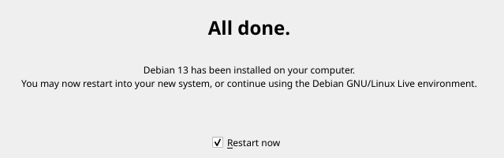
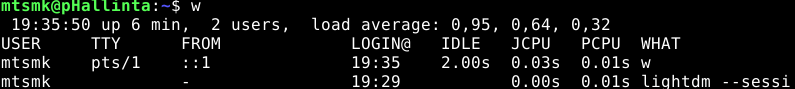
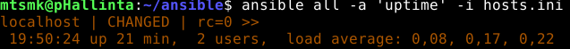
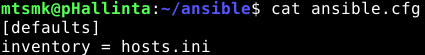
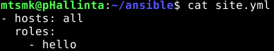
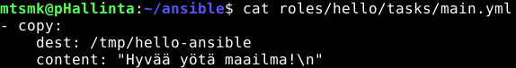
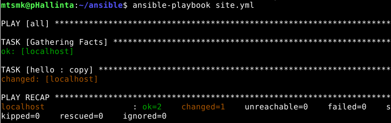
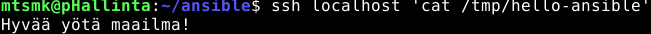

# 1. Hei Ansiblen maailma!

## x) Lue ja tiivistä

### SSH public key - Login without password [(terokarvinen.com)](https://terokarvinen.com/ssh-public-key-login-without-password/) 

- SSH on johtava ratkaisu suojatun etäyhteyden muodostamiseen toiseen tietokoneeseen. SSH-yhteyttä käyttävät myös monet muut työkalut, kuten Git, rsync ja Ansible.

- Julkisen avaimen tunnistautumisessa käytetään avainparia, joka koostuu yksityisestä ja julkisesta avaimesta.

- Julkisen avaimen tunnistautuminen on kätevää, sillä silloin ei tarvitse erikseen kirjoittaa salasanaa aina, kun palvelua käytetään.

Oma huomio: Pelkkä avainparilla kirjautuminen ei tee palvelimesta täysin turvallista, jos perinteinen salasanakirjautuminen jätetään taustalle päälle.

#### Hyödyllisiä komentoja
   SSH:n asennus:
````
sudo apt-get -y install ssh
````
 Demonin käynnistys ja määrittäminen käynnistymään koneen mukana:
````
sudo systemctl enable --now ssh
````
 SSH:n testaus:
````
ssh localhost
w
````
 Avainparin luominen:
````
ssh-keygen
````
Julkisen SSH-avaimen kopioiminen kohdekoneelle:
````
ssh-copy-id käyttäjä@kohdekone
````
Troubleshoottaus-komentoja:
- Client:
````
ssh -v localhost
````
- Server
````
sudo journalctl --follow
sudo systemctl status ssh
````

### Hello Ansible [(terokarvinen.com)](https://terokarvinen.com/hello-ansible/)

- Ansible on konfiguraationhallintatyökalu, jossa haluttu lopputila kuvaillaan koodina. Muutoksia tehdään vain silloin, jos kohdekone ei jo valmiiksi vastaa määriteltyä tilaa.

- Ansible käyttää SSH-yhteyttä hallittavaan koneeseen. Kohdekoneella tarvitaan SSH-palvelin ja Python, mutta sinne ei tarvitse asentaa erillistä Ansible-palvelua.

- Hallittavat koneet määritellään inventaariotiedostossa, esimerkiksi hosts.ini-tiedostossa. Yhteyttä voidaan testata komennolla *ansible all -a 'uptime' -i hosts.ini*.

- *site.yml* määrittelee, mitkä roolit suoritetaan hallittaville koneille. Roolin tehtävät sijoitetaan esimerkiksi tiedostoon *roles/hello/tasks/main.yml*.

- Ansible-playbook suoritetaan komennolla *ansible-playbook site.yml*. Lopputulos tarkistetaan sekä suoritusraportista että tarvittaessa erillisellä testillä, kuten lukemalla luodun tiedoston sisältö.

Kysymys: Jos inventaariotiedostoon määritellään satoja eri palvelimia, suorittaako Ansible komennot niille kaikille rinnakkain vai yksi kerrallaan.

## a) Paikallista. Asenna Debian 13 paikallisesti virtuaalikoneeseen.
### Debianin asennus Virtualbox Managerilla.

Loin VirtualBox Managerilla uuden virtuaalikoneen kurssia varten. Virtuaalikoneen luonnissa seurasin seuraavia ohjeita: [terokarvinen.com](https://terokarvinen.com/2021/install-debian-on-virtualbox/)

VM:n asetukset:
- ISO Image: debian-live-13.7.0-amd64-xfce.iso
- OS: Linux
- OS Version: Debian (64-bit)
* Base Memory: 4000MB
* CPUs: 2
* Use EFI: ☑
- Disk Size: 60GB
- File Type and Format: VDI

Seuraavaksi käynnistin koneen live-ympäristöön ja varmistin selaimen avulla, että hiiri, näppäimistö, verkko ja näyttö toimivat. Tämän jälkeen avasin asennusohjelman ja määritin seuraavat asetukset:
- Language: American English
* Region: Europe
* Zone: Helsinki
- Keyboard model: Generic 105-key PC (Finnish Default)
* Erase disk: ☑
- Your name: Matias Mäki
- Name for login: mtsmk
- Name of the computer: pHallinta
- Salasana:
- Log in automatically without password: x



Asennuksen valmistuttua käynnistin koneen uudelleen ja varmistin tein saman testin selaimella. Sitten päivitin järjestelmän pakettiluettelot ja asennetut paketit, asensin ja otin käyttöön palomuurin sekä Guest Additions-lisäosat.

Pakettilistojen ja pakettien päivitys:
```
sudo apt-get update
sudo apt-get upgrade
```
Palomuurin asennus ja käyttöönotto:
```
sudo apt-get -y install ufw
sudo ufw enable
```
Guest Additions asennus:

&nbsp;&nbsp;&nbsp;&nbsp;1. Devices > Insert Guest Additions CD Image...

&nbsp;&nbsp;&nbsp;&nbsp;2. File Manager > VBox_GAs_x

Sitten Terminal Emulatoriin seuraavat komennot:
````
cd /media/*/VBox*
ls
sudo bash VBoxLinuxAdditions.run
````
Sitten käynnistin koneen uudestaan ja laitoin jaetun clipboardin päälle, ja varmistin sen toimivan kopioimalla omalta koneeltani tekstiä VM:n selaimeen.

## b) Sshecrets. Asenna SSH-demoni käsin ja testaa se kirjautumalla SSH:lla.
### SSH-demonin asennus ja toiminnan testaus.

Ensimmäiseksi päivitin pakettilistat ja asensin OpenSSH-server paketin komennoilla:
```
sudo apt-get update
sudo apt-get -y install ssh
```
Tämän jälkeen käynnistin SSH-palvelun ja asetin sen käynnistymään automaattisesti virtuaalikoneen käynnistyksen yhteydessä.
````
sudo systemctl enable --now ssh
````
Sitten varmistin, että ssh toimii:
````
ssh localhost
w
````


## c) Pubkey. Automatisoi ssh-kirjautuminen julkisella avaimella.
### SSH-kirjautumisen automatisoiminen julkisella avaimella

Ensimmäiseksi loin avaimen syöttämällä seuraavan komennon ja hakkaamalla enteriä.
````
ssh-keygen
````
Sitten kopioin avaimen palvelimille, joihin minulla on jo pääsy:
````
ssh-copy-id localhost
````

Lopulta varmistin automatisoidun kirjautumisen toimivan suorittamalla saman testin kuin ssh:n asennuksen yhteydessä. Tällä kertaa kirjautuminen ei vaatinut salasanan kirjoittamista.

## d) Hei Ansible. Tee hei maailma ansiblella ja kokeile sitä SSH:n yli.
### Ansiblen asennus, hallittavan koneen määritys ja playbookin suorittaminen SSH-yhteyden kautta.

Kuten b) vaiheesta näkee, SSH:n käyttö toimii hyvin ilman Ansiblea, joten ensimmäiseksi asensin Ansiblen.
````
sudo apt-get install ansible
````
Tämän jälkeen loin kotihakemistoon ansible-hakemiston ja siirryin siihen. Sinne loin *hosts.ini*-tiedoston, johon määrittelin halliteltavaksi koneeksi localhostin. (ja lisäsin hosts.ini-tiedostoon Python-tulkin määrityksen, jotta Ansible käyttäisi järjestelmän Python 3 -tulkkia eikä näyttäisi siitä toistuvaa varoitusta)


Seuraavaksi testasin, että Ansible pystyi suorittamaan komennon hallittavalla koneella SSH-yhteyden kautta:
````
ansible all -a 'uptime' -i hosts.ini
````


Sitten loin *ansible.cfg*-tiedoston ja määritin siihen oletusinventaarion, jotta minun ei tarvitse syöttää sitä erikseen jokaisen komennon yhteydessä.



Seuraavaksi loin *site.yml*-tiedoston roolien kohdentamista varten. Tässä tapauksessa määrittelin hello-roolin ajettavaksi kaikilla inventaarion määrittämillä palvelimilla.



Tämän jälkeen loin roolille tarvittavat hakemistot:
````
mkdir -p roles/hello/tasks/
````
Tämän jälkeen loin tiedoston *roles/hello/tasks/main.yml* ja määrittelin siihen tehtävän, joka luo /tmp/*hello-ansible*-tiedoston ja kirjoittaa siihen tekstin.



Sitten oli aika suorittaa playbook seuraavalla komennolla:
````
ansible-playbook site.yml
````
Tarkistin suorituksen tulosteesta, että toiminto onnistui ongelmitta.



Ja lopuksi varmistin vielä, että tiedosto oli luotu ja sen sisältö oli oikea.



## Lähteet
Karvinen, T. 2021. Install debian on virtual box. Luettavissa: https://terokarvinen.com/2021/install-debian-on-virtualbox/. Luettu: 23.10.2026

Karvinen, T. 2026. Hello Ansible. Luettavissa: https://terokarvinen.com/hello-ansible/. Luettu 23.10.2026

Karvinen, T. 2026. SSH public key - Login without password. Luettavissa: https://terokarvinen.com/ssh-public-key-login-without-password/. Luettu: 23.10.2026