# h2 Voileipä

## x) Lue ja tiivistä.

### Sudo without password [(terokarvinen.com)](https://terokarvinen.com/passwordless-sudo/) 

- Artikkelissa käsitellään salasanattoman sudon käyttöön ottoa Linuxissa.

- Sudoers-aseetuksilla voidaan antaa käyttäjälle tai ryhmälle oikeus suorittaa komentoja pääkäyttäjänoikeuksilla ilman salasanan kysymistä.

```
$ cat /etc/sudoers.d/sudoless
%sudoless ALL = (ALL) NOPASSWD: ALL
```
Oma kysymys: Miten salasanattoman sudon käyttöä voisi rajoittaa niin, ettei käyttäjällä ole oikeutta suorittaa aivan kaikkia komentoja?

#### Hyödyllisiä komentoja

Käyttäjän luonti: `sudo adduser username`

Ryhmän luonti: `sudo groupadd groupname`

Käyttäjän lisääminen ryhmään: `sudo adduser username groupname`

### Sandwich [(xkcd.com)](https://xkcd.com/149/)

- Sarjakuvassa kuvataan humoristisesta näkökulmasta, miten `sudo`-komento ohittaa järjestelmän normaalit käyttäjärajoitukset.

Oma huomio: Tässäkin järjestelmässä on konfiguroitu salasanaton sudon käyttö.

### Passwordless Sudo with Ansible [(terokarvinen.com)](https://terokarvinen.com/passwordless-sudo-with-ansible/)

- Artikkelissa käsitellään salasanattoman sudon käyttöön ottoa Ansiblella

- `become: true` mahdollistaa tehtävien suorittamisen sudo-oikeuksilla

Oma huomio:

#### Hyödyllisiä komentoja

Sudo-salasanan kysyminen playbookkia suoritettaessa onnistuu laittamalla `ansible-playbook site.yml`-komennon perään joko `--ask-become-password` tai `-K`.

### ansible-doc

#### ansible-doc copy

- Moduuli kopioi tiedostoja tai hakemisto rakenteita joko paikalliselta tai etäkoneelta toiseen paikkaan etäkoneella. Tiedoston metatiedot voidaan määrittää samalla, vaikka kohde olisi jo olemassa.

##### Nimetyt optiot

- `content`: Asettaa tiedoston sisällön suoraan määritettyyn arvoon. Toimii vain silloin, kun kohde on tiedosto. Luo tiedoston, jos sitä ei ole valmiiksi olemassa.

- `dest`: Ehdoton etäpolku, johon tiedosto kopioidaan.

- `src`: Paikallinen polku kopioitavaan tiedostoon tai hakemisto

- `owner`: Tiedoston/hakemiston omistajaksi asetettava käyttäjänimi

- `group`: Tiedoston/hakemiston omistajaksi asetettava ryhmänimi

- `mode`: Tiedostolle annettavat käyttöoikeudet (Esim. "0644")

##### Esimerkki

Kopioi tiedosto, sen omistaja ja käyttöoikeudet:

```
- name: Copy file with owner and permissions
  ansible.builtin.copy:
    src: /srv/myfiles/foo.conf
    dest: /etc/foo.conf
    owner: foo
    group: foo
    mode: '0644'
```

#### ansible-doc apt

- Hallitsee apt-paketteja

##### Nimetyt optiot

- `name`: Käsiteltävän paketin tai pakettien nimi

- `state`: Paketin haluttu tila
    - `present`: Asennettu
    - `absent`: Poistettu
    - `latest`: Viimeisin versio

- `update_cache`: Päivittää paketti varaston ennen paketin käsittelyä

##### Esimerkki

Poista paketti:

```
- name: Remove "foo" package
  ansible.builtin.apt:
    name: foo
    state: absent
```

#### ansible-doc file

- Määrittää tiedostojen, symlinkkien ja hakemistojen attribuutteja. Luo tai poistaa hakemistoja ja linkkejä.

##### Nimetyt optiot

- `path`: Polku muokattavaan tiedostoon

- `recurse`: Rekursiivisesti asettaa määritetyn tiedoston attribuutit hakemiston sisällölle

- `src`: Polku, johon luootava symlinkki viittaa

- `state`: Kohteen tyyppi tai tila

- `owner / group / mode`: Omistaja, ryhmä ja oikeudet (Kuten copy-moduulissa) 


##### Esimerkki

Muokkaa tiedoston omistajaa, ryhmää ja oikeuksia:

```
- name: Change file ownership, group and permissions
  ansible.builtin.file:
    path: /etc/foo.conf
    owner: foo
    group: foo
    mode: '0644'
```

#### ansible-doc user

- Hallitsee järjestelmän käyttäjätilejä ja niiden attribuutteja.

##### Nimetyt optiot

- `name`: Luotavan, muokattavan tai poistettavan käyttäjän käyttäjätunnus

- `create_home`: Luodaanko käyttäjälle kotihakemisto (Oletuksena kyllä)

- `comment`: Kuvaus käyttäjästä

- `groups`: Lista ryhmistä, joihin käyttäjä lisätään

- `shell`: Käyttäjän oletusshell

- `state`: Onko käyttäjä olemassa

- `system`: Onko kyseessä järjestelmäkäyttäjä

##### Esimerkki

Luo käyttäjä `johnd` kotihakemistoineen:

```
- name: Create a user 'johnd' with a home directory
  ansible.builtin.user:
    name: johnd
    create_home: yes
```

#### ansible-doc authorized-key

- Lisää tai poistaa SSH-avaimia määrättyjen käyttäjien authorized_keys-tiedostosta

##### Nimetyt optiot

- `user`: Paikallisen käyttäjän nimi, jonka SSH-avaimia muokataan

- `key`: Itse SSH-avain merkkijonona tai polku/URL, josta avain haetaan

##### Esimerkki

Aseta valtuutettu avain linkistä:

```
- name: Set authorized keys taken from url
  ansible.posix.authorized_key:
    user: charlie
    state: present
    key: https://github.com/charlie.keys
```

## a) Sudoless. Tee ansiblea varten tunnus, jolla voi käyttää sudoa ilman salasanaa.
### Käyttäjän ja ryhmän luominen sekä käyttäjän lisääminen ryhmään.

Ensimmäiseksi loin käyttjän nimeltä `hiekka`.

    sudo adduser hiekka

Tämän jälkeen loin ryhmän nimeltä `sudoless`.

    sudo groupadd sudoless

Sitten lisäsin juuri luomani käyttäjän luomaani ryhmään.

    sudo adduser hiekka sudoless

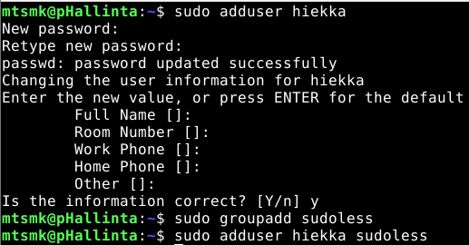

### Salasanattoman sudon käytön mahdollistavan aseutksen luonti

Tässä vaiheessa avasin taustalle toiseen terminaaliin pääkäyttäjän istunnon komennolla.

    sudo -i

Tämän jälkeen perusikkunassa loin tiedoston `sudoless` hakemistoon `/etc/sudoers-d/`.

    sudo visudo /etc/sudoers.d/sudoless

Tiedoston sisälle laitoin seuraavan rivin, joka antaa `sudoless`-ryhmälle oikeuden suorittaa mitä tahansa komentoja ilman salasanaa.

    %sudoless ALL = (ALL) NOPASSWD: ALL

Lopuksi varmistin salasanattoman sudon toiminnan ottamalla SSH-yhteyden ``hiekka``-käyttäjään ja testaamalla sudo-komentoa.

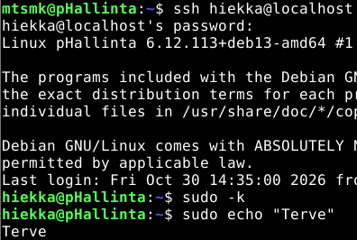

## b) Antero. Tee salasanaton, automaattisesti ssh:lla kirjautuva tunnus Ansiblella.
### Sitten laitetaan Ansible suorittamaan vastaava tehtävä.

Ensimmäiseksi loin uuden roolin `sudoless`, jonka sisälle loin hakemiston `tasks`, jonne lisäsin tiedoston `main.yml`

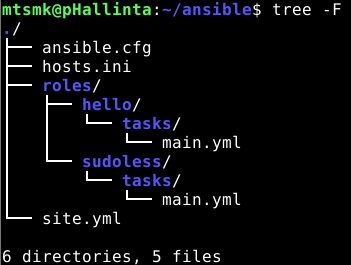

`main.yml`-tiedostoon lisäsin seuraavan sisällön, joka:
1. Luo ryhmän `sudoless`
2. Luo `noita`-nimisen käyttäjän ja lisää sen ryhmiin `sudoless`, `sudo` ja `adm`
3. Lisää määritetyn julkisen avaimen käyttäjän `noita` valtuutettujen avainten listalle salasanatonta SSH-kirjautumista varten
4. Luo tiedoston `/etc/sudoers.d/sudoless`, joka sallii kaikille `sudoless`-ryhmän jäsenille sudo-oikeuksien käyttämisen ilman salasanakyselyä
```
- group:
    name: "sudoless"
    state: present
- user:
    name: "noita"
    state: present
    groups: ["sudoless", "sudo", "adm"]
- authorized_key:
    user: "noita"
    key: "Oma julkinen avain"
- copy:
    dest: "/etc/sudoers.d/sudoless"
    content: "%sudoless ALL = (ALL) NOPASSWD: ALL\n"
    owner: "root"
    group: "root"
    mode: "0644"
```

Seuravaksi lisäsin `sudoless`-roolin `site.yml`-tiedostoon sen ajamista varten. Lisäksi määritin tiedostoon asetuksen `become: true`, jotta Ansible suorittaa tehtävät kohdejärjestelmässä sudo-oikeuksilla.

`site.yml`-sisältö tämän vaiheen jälkeen:

````
- hosts: all
  become: true
  roles:
    - hello
    - sudoless
````
Sitten oli aika suorittaa playbook.

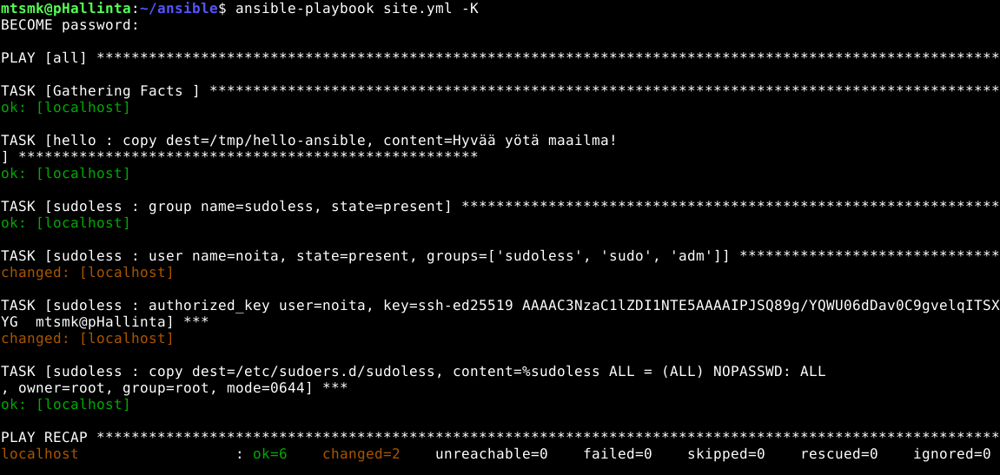

Tuloksista ilmenee, että järjestelmään luotiin onnistuneesti uusi käyttäjä ``noita`` ja määritetty SSH-avain lisättiin sen valtuutettujen avainten luetteloon. Sen sijaan ``sudoless-ryhmää`` tai ``sudoless``-asetustiedostoa ei luotu uudelleen, sillä ne olivat jo valmiiksi olemassa järjestelmässä edellisen tehtävän jäljiltä.

Lopuksi vielä varmistin salasanattoman sudon toiminnan ottamalla SSH-yhteyden ``noita``-käyttäjään ja testaamalla sudo-komentoa

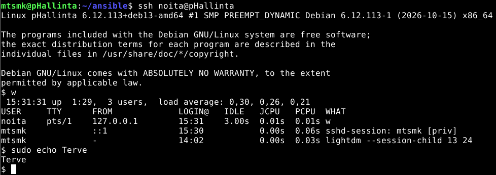

## c) Package. Asenna kaksi pakettia ansiblella.
### Asennetaan kaksi pakettia Ansiblella.

Ensimmäiseksi loin uuden roolin `tupac`, jonka sisälle loin hakemiston `tasks`, jonne lisäsin tiedoston `main.yml`

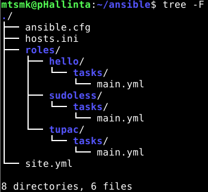

`main.yml`-tiedoston lisäsin seuraavan sisällön, jossa määritetään:
1. Päivitä pakettilistat jos edellisestä kerrasta on kulunut 3600 sekuntia
2. Varmistaa, että seuraavista paketeista on asennettu viimeisimmät versiot: git ja htop

```
- name: Paketti update
  ansible.builtin.apt:
    update_cache: true
    cache_valid_time: 3600 

- name: Asenna kaksi pakettia
  ansible.builtin.apt:
    pkg:
    - git
    - htop
    state: latest
```

Sitten lisäsin aiemmin luomani roolin `site.yml`-tiedostoon.

````
- hosts: all
  become: true
  roles:
    - hello
    - sudoless
    - tupac
````

Vielä ennen playbookin suoritusta varmistin, että asennettavia paketteja ei jo löydy koneeltani.

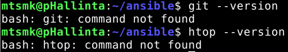

Sitten suoritin playbookin.

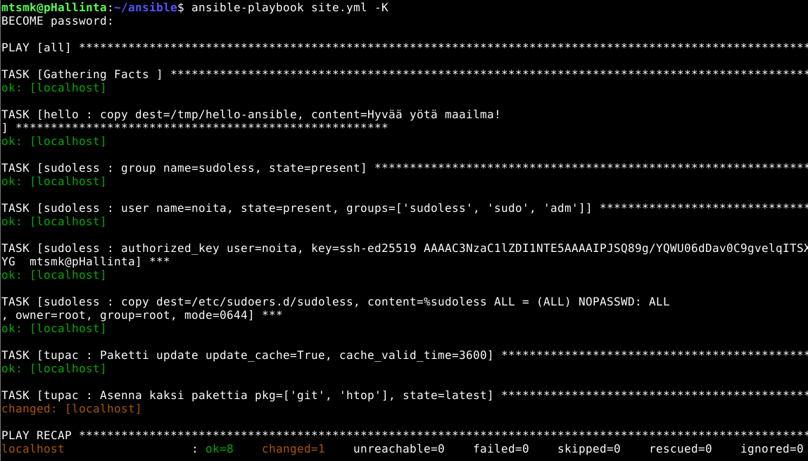

Kuten kuvasta näkyy, muutos tapahtui. Tässä vaiheessa myös tajusin kommentoida aiempien tehtävien roolit pois käytöstä, jotta Ansible ei käy niitä läpi joka kerralla. Lopuksi vielä varmistin, että halutut paketit asentuivat halutusti.

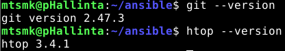

## d) File. Kirjoita orjalle useamman rivin mittainen tiedosto Ansiblella. Määrittele sen omistaja, omistava ryhmä ja oikeudet. Käytä oikeuksille oktaalinumeroa ja selitä, mitä kukin käyttäjä saa tehdä tuolle tiedostolle.
### Monirivisen tiedoston luonti

Jälleen loin uuden roolin `defright`, jonka sisälle loin hakemiston `tasks`, jonne lisäsin tiedoston `main.yml`

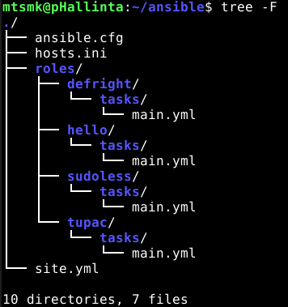

`main.yml`-tiedostoon lisäsin seuraavan sisällön, jossa:
1. Määritetään sijainti
2. On monta riviä sisältöä
3. Määritetään omistajaksi `noita`
4. Määritetään ryhmäksi `noita`
5. Määritetään oikeuksiksi `0644` eli `-rw-r--r--`.
    1. `6 / rw-` = Omistajalla on luku- ja kirjoitusoikeus
    2. `4 / r--` = Ryhmällä on lukuoikeus
    3. `4 / r--` = Muilla on lukuoikeus
```
- copy:
    dest: /tmp/noita-monirivi
    content: |
      1. Rivi
      2. Rivi
      3. Rivi
      4. Rivi
    owner: noita
    group: noita
    mode: "0644"
```
Sitten lisäsin roolin `defright` tiedostoon `site.yml`.

````
- hosts: all
  become: true
  roles:
    - hello
    - defright
````
Seuraavaksi suoritin playbookin.

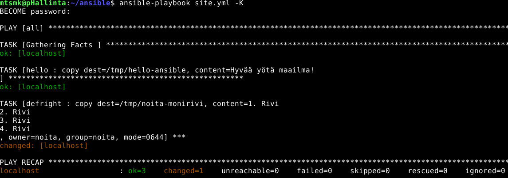

Lopuksi varmistin, että tiedosto onnistuneesti luotiin ja oikeudet toimivat.

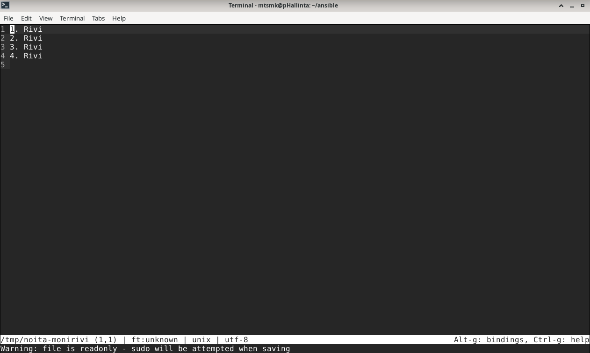

Kuvan yläreuna osoittaa, että tiedosto avautuu käyttäjälle `mtsmk` oikein. Alareunasta näkyvä vain luku -tila puolestaan varmistaa, että myös rajoitetut kirjoitusoikeudet pätevät.

## e) Jotain muuta.
### Tehdään rooli, joka poistaa edellisessä tehtävässä luodun tiedoston.

Eli demonstroidaan `ansible.builtin.file`-moduulin `absent`-tilaa. Sen avulla voidaan varmistaa, ettei määriettyä tiedostoa ole järjestelmässä. 

#### Toteutus

Jälleen uusi `roles/roolin_nimi/tasks/main.yml`. Tällä kertaa roolin nimeksi päätyi `del`.

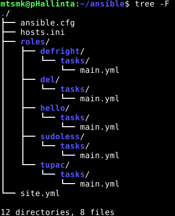

Lisätään `main.yml`-tiedostoon seuraava `ansible-doc`:ista peräisin oleva pätkä, jossa:
1. Määritetään käsiteltävä tiedosto
2. Määritetään tiedostolle haluttu tila (Tässä tapauksessa "poissa oleva")

````
- name: Remove file (delete file)
  ansible.builtin.file:
    path: /tmp/noita-monirivi
    state: absent
````
Sitten juoksutetaan playbookkia.

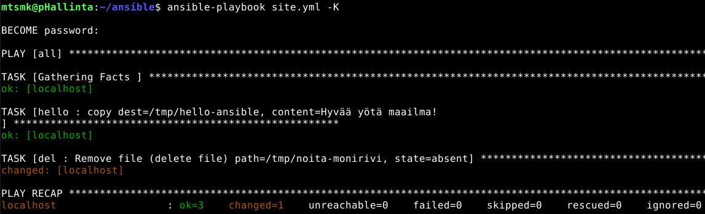

Lopuksi varmistetaan, että tiedostoa ei enää löydy.

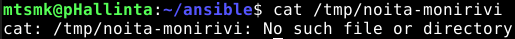

## Lähteet

Ansible. ansible-doc: copy, apt, file, user ja authorized_key. Ansible-moduulien dokumentaatio. Luettu 31.10.2026

Karvinen T, 2026. Passwordless Sudo with Ansible. Luettavissa: https://terokarvinen.com/passwordless-sudo-with-ansible/. Luettu 30.10.2026

Karvinen T, 2026. Sudo without password. Luettavissa: https://terokarvinen.com/passwordless-sudo/. Luettu 30.10.2026

Munroe M, 2006. Sandwich. Luettavissa: https://xkcd.com/149/. Luettu 31.10.2026