# h3 Demoni

## x) Lue ja tiivistä.
### Apache installed with Ansible [(terokarvinen.com)](https://terokarvinen.com/apache-ansible/)

Artikkelissa tiivistetään Apachen asentaminen Ansiblella:
- Package-file-service: Palvelinohjelma asennetaan ja sen konfiguraatiotiedosto kopioidaan paikalleen. Lopuksi palvelu käynnistetään uudelleen, jotta muutokset tulevat voimaan.
- Verkkosivun sisältö tallennetaan niin, että sivuja voi muokata tavallisena käyttäjänä ilman pääkäyttäjän oikeuksia.

Oma huomio: Niin oikeasti tuo sivuston sisältö varmaan tallennettaisiin kotihakemiston sijasta johonkin yhteiseen web-hakemistoon, johon määritettäisiin kirjoitusoikeudet erilliselle webkehittäjä-ryhmälle.

### Handlers: running operations on change [(docs.ansible.com)](https://docs.ansible.com/projects/ansible/latest/playbook_guide/playbooks_handlers.html)

Artikkelissa kerrotaan mitä handlerit ovat:
- Handlerit ovat taskeja, jotka suoritetaan vain, kun jokin perustaski muuttaa järjestelmän tilaa ja ilmoittaa (`notify`) siitä. Niitä käytetään tyypillisesti taustapalveluiden uudelleenkäynnistämiseen konfiguraatiomuutosten jälkeen.
- Handlerit suoritetaan siinä järjestyksessä kuin ne on kirjoitettu `handlers`-osioon. Vaikka useampi taski kutsuisi samaa handleria, se ajetaan vain kerran.
- Handlerit täytyy nimetä `notify`-kutsua varten. Handlereille voi antaa `listen`-aiheen, jolloin yksi `notify`-kutsu voi kutsua useita handlereita, jotka kuuntelevat samaa aihetta.

Oma kysymys: Jos jokin playbookin myöhempi taski epäonnistuu ja koko ajo pysähtyy, ajetaanko siihen asti pyydetyt handlerit silti, vai jäävätkö ne kokonaan suorittamatta?

### 'ansible-doc service'

- Moduulilla hallitaan kohdekoneiden palveluita.

- `enabled`: Määrittää, käynnistyykö palvelu automaattisesti koneen käynnistyessä.

- `name`: Määrittää hallittavan palvelun nimen.

- `state`: Määrittää palvelun tilan

#### Esimerkki

Käynnistä palvelu httpd, jos se ei ole käynnissä:

```
- name: Start service httpd, if not started
  ansible.builtin.service:
    name: httpd
    state: started
```

## a) Apassi. Asenna Apache 2 käsin.
### Asennetaan Apache 2 käsin, niin että webbisivu näkyy palvelimen etusivulla ja se on tavallisen käyttäjän muokattavissa ilman sudo- tai root-oikeuksia.

Aloitin ottamalla edeltävällä tunnilla käytetyn Caddyn pois päältä komennolla `systemctl disable --now caddy.service`

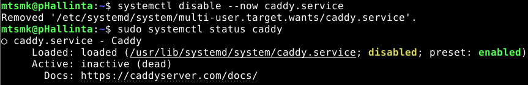

Seuraavaksi päivitin pakettilistan ja asensin Apachen
```
sudo apt update
sudo apt install apache2 -y
```
Tämän jälkeen varmistin, että asentamani demoni pelittää komennolla `systemctl status apache2`.

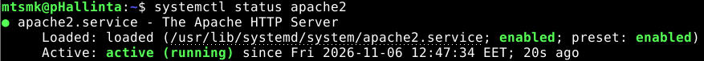

Lisäksi varmistin default-sivun näkyvän selaimessa.

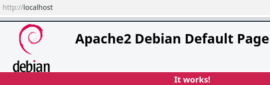

### Seuraavaksi sivu piti saada muokattavaksi ilman sudoja.

Päätin toteuttaa tämän vaiheen luomalla ryhmän, johon kuuluvat käyttäjät voivat muokata sivua ilman sudo-oikeuksia.

Ensimmäiseksi loin uuden ryhmän nimeltä _webdev_ ja lisäsin käyttäjäni siihen. Vastaava vaihe käytiin tarkemmin läpi h2-voileipä-kotitehtävän kohdassa a).

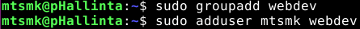

Seuraavaksi määritin web-palvelimen default-sivun hakemiston _webdev_-ryhmän omistukseen komennolla `sudo chown -R root:webdev /var/www/html`. Lisäksi määritin hakemistolle haluamani oikeudet komennolla `sudo chmod -R 2775 /var/www/html`.

2. SGID: Kun kansioon luodaan uusi tiedosto tai alihakemisto, se perii automaattisesti tämän kyseisen hakemiston ryhmän.
<!-- -->
7. Omistajan oikeudet: Luku, kirjoitus ja suoritus
<!-- -->
7. Ryhmän oikeudet: Luku, kirjoitus ja suoritus
<!-- -->
5. Muiden oikeudet: Luku ja suoritus

Sitten varmistin, että tulos on haluamani näköinen.


## b) Moottorix. Asenna Nginx käsin.
### Asennetaan Nginx käsin, niin että webbisivu näkyy palvelimen etusivulla ja se on tavallisen käyttäjän muokattavissa ilman sudo- tai root-oikeuksia.

Sitten oli aika tehdä sama, mutta Nginx:llä. Ensimmäiseksi, taas otin aiemmin käytetyn web-palvelimen pois käytöstä.

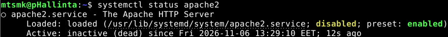

Sitten taas varmistin, että demoni pelaa komennolla `sudo systemctl status nginx.service`.

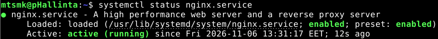

Sitten tehtävä onkin valmis, koska Nginx käyttää default-sivulleen samaa polkua kuin Apache. Täten kohdassa a) määritetyt oikeudet pätevät edelleen.

Tässä vielä todiste, että sivun sisällön muuttaminen onnistuu ilman sudo-oikeuksia ja tällä kertaa käytössä Nginx.

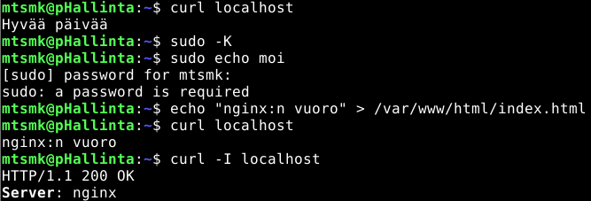


## c) Automoottorix. Automatisoi Nginx asennus Ansiblella.
### Automatisoidaan ylläpitäjän osuus Nginx:n asennuksesta Ansiblella.

Sitten laitetaan Anssi asentamaan Nginx. Tehtävän teossa sovelsin Tero Karvisen artikkelia _[Apache installed with Ansible - quick notes](https://terokarvinen.com/apache-ansible/)_.

Ensimmäiseksi laitoin ansible-hakemistoni haluttuun kuosiin:

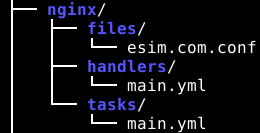

```
mkdir roles/nginx/tasks -p
mkdir roles/nginx/files
mkdir roles/nginx/handlers
```

Seuraavaksi lisäsin `nginx/tasks`-hakemistoon tiedoston `main.yml`, jonka sisällössä:
1. Varmistetaan nginx:n olevan asennettuna kohdekoneeseen.
2. Kopioidaan esimerkki-sivun konfiguraatio kohdekoneelle.
3. Otetaan kyseinen sivu käyttöön.

```
- name: Varmistetaan nginx:n olemassaolo
  apt:
    name: nginx
    state: present

- name: Kopioidaan nginx-konfiguraatio kohdekoneelle
  copy:
    dest: /etc/nginx/sites-available/esim.com.conf
    src: esim.com.conf
    owner: root
    group: root
    mode: "0644"
  notify: restart nginx

- name: Aktivoidaan sivu 
  file:
    src: /etc/nginx/sites-available/esim.com.conf
    dest: /etc/nginx/sites-enabled/esim.com.conf
    state: link
  notify: restart nginx
```

Sitten lisäsin ``nginx/handlers``-hakemistoon tiedoston `main.yml`-tiedoston, jossa määritellään nginx käynnistymään uudestaan handleria kutsuttaessa.
```
- name: restart nginx
  systemd:
    name: nginx
    state: restarted
```

Lopuksi tein `nginx/files`-hakemistoon tiedoston `esim.com.conf`, jossa määritellään mikä on uusi default-sivu ja mistä se haetaan. Käytin tässä taas samaa hakemistoa, kuin aiemmassa kahdessa tehtävässä, jolloin _webdev_-ryhmään kuuluvat käyttäjät voivat muokata sivustoa ilman sudo-oikeuksia.
```
server {
    listen 80 default_server;
    listen [::]:80 default_server;

    server_name _;

    root /var/www/html;
    index index.html;

    location / {
        try_files $uri $uri/ =404;
    }
}
```

Sitten suoritin playbookin ja homma toimii, vaan eipäs toiminukkaan. Syynä tälle oli, että _Aktivoidaan sivu_-kohdasta jäi puuttumaan tuo `state: link`. (Valitettavasti kuvankaappaukseni tästä errorista katosi jonnekin) Onneksi tämä ongelma oli helposti ratkottavissa ja playbookia voitiin juoksuttaa taas uudelleen ja näin homma toimii.

Tai sitten ei.

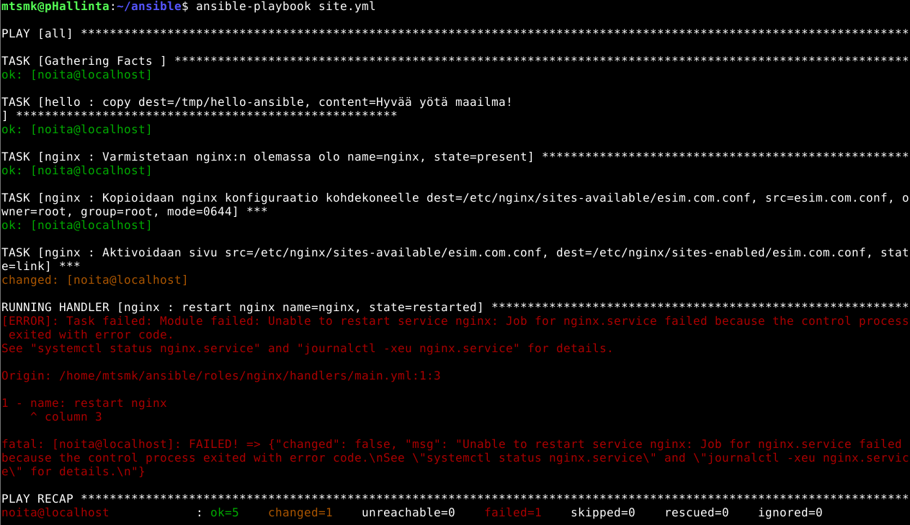

Nginx:n uudelleenkäynnistäminen ei jostain syystä onnistu.

Lähdin ratkomaan ongelmaa komennolla `sudo nginx -t`, joka testaa Nginx:n asetustiedostojen syntaksin ja tarkistaa, onko konfiguraatiossa virheitä.

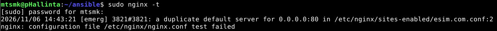

Sieltä palautteena tuli, että default servereitä on määritetty enemmän kuin yksi, jolloin nginx:n buuttaaminen ei onnistu. Huppista, joltain tais jäädä Nginx:n default-sivu aktivoituihin sivuihin. Onneksi tähän oli helppo fiksi.

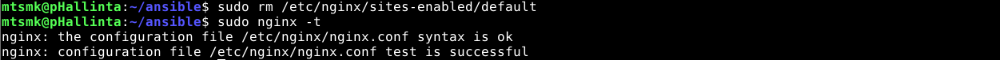

Eli poistin tuon default-sivun käytöstä poistamalla sen `rm`-komennolla `sites-enabled`-hakemistosta. Tämän jälkeen suoritin `sudo nginx -t`-testin uudestaan ja sehän tuli puhtaana läpi.

Ja näin homma saatiin pelittämään kun taas suoritettiin Playbook uudelleen.

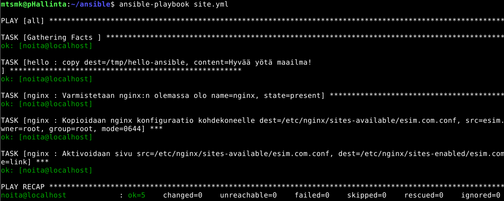

Ja näin. Lopulta sitten testasin, että sivu näkyy ja sen sisältö on muutettavissa ilman sudo-oikeuksia.

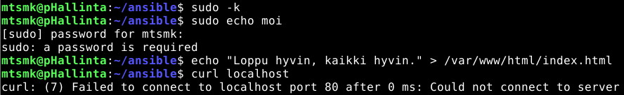

Ai jaha. Sivuston sisällön muuttaminen onnistui ilman sudo-oikeuksia, mutta palvelimeen ei saada yhteyttä.

Aloitin katsomalla mikä on Nginx:n tilanne. `sudo systemctl status nginx`

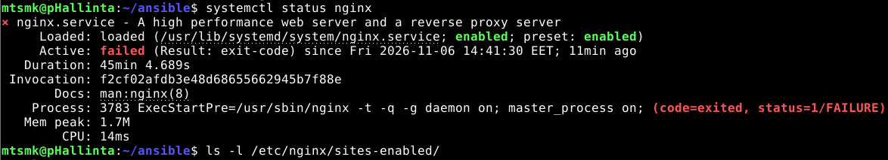

Tilanne ei ollut hyvä, joten päätin käyttää sitä parasta kikkaa kun jokin ei pelitä.

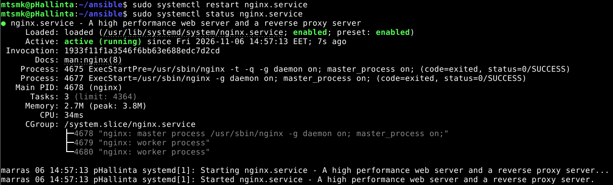

Eli siis buuttasin palvelimen ja kappas keppanaa homma toimi taas.

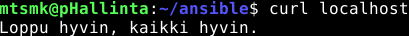

### No mikäs tässä sitten oli ongelmana? 

Unohdin poistaa käytöstä Nginx:n alkuperäisen default-sivun.

↓

Kaksi `default_server`-määritystä aiheutti käynnistysvirheen.

↓

Default-sivun käytöstä poistamisen jälkeen asetukset korjaantuivat.

↓

Ajoin playbookin uudelleen ilman virheitä.

↓

Koska uusia muutoksia ei havaittu, restart-handleria ei suoritettu.

↓

Nginx ei käynnistynyt automaattisesti uudelleen, vaan jäi pysäytetyksi.

### Miten välttää ongelma?

Lisäsin `tasks/main.yml`.tiedostoon ennen oman sivuston aktivointia vaiheen, jossa poistetaan tuo default-sivu käytöstä.
```
- name: Poistetaan alkuperäinen oletussivu käytöstä
  ansible.builtin.file:
    path: /etc/nginx/sites-enabled/default
    state: absent
  become: true
  notify: restart nginx
```

## Lähteet

Ansible. ansible-doc: service. Ansible-moduulien dokumentaatio. Luettu 6.11.2026

Ansible Community Documentation. Handlers: running operations on change. Luettavissa: https://docs.ansible.com/projects/ansible/latest/playbook_guide/playbooks_handlers.html. Luettu 6.11.2026

Karvinen T, 2026. Apache installed with Ansible - quick notes. Luettavissa: https://terokarvinen.com/apache-ansible/. Luettu 6.11.2026
