# Pizza Fantasia
## x) Lue ja tiivistä.
### Karvinen T, 2023. [Configuration Management of Distributed Systems over Unreliable and Hostile Networks](https://westminsterresearch.westminster.ac.uk/item/w7vvz/configuration-management-of-distributed-systems-over-unreliable-and-hostile-networks).

#### 4.12.1 Size and Complexity of Some DSLs

- Konfiguraationhallintatyökalujen omat ohjelmointikielet voivat olla todella laajoja ja monimutkaisia.
- Saltissa on 510 toimintoa ja niiden dokumentaatiossa yli 20 000 riviä. Puppetissa on puolestaan 113 valmista toimintoa.
- Suuri toimintojen määrä ja omat ohjelmointirakenteet voivat tehdä työkalun opettelusta vaikeaa.

Oma huomio: Yllättävän suuria nuo toimintojen määrät. Olisi mielenkiintoista tietää kuinka usein kaikkia 510 komentoa oikeasti käytetään.

#### 4.12.2 Use of DSL Functions in Case Configuration

- Tutkimuksessa tarkasteltiin oikeita Puppet-konfiguraatioita Mozillalta ja Yhdysvaltain hallinnolta.
- Vaikka työkaluissa on paljon toimintoja, käytännön konfiguraatioissa käytetään vain pientä osaa niistä.
- Yleisimpiä toimintoja ovat package, file ja service.

Oma huomio: Käytetyimpien toimintojen lista kattaa aika pitkälti kaiken, mitä tällä kurssilla on toistaiseksii käsitelty.

#### 4.12.3.1 Dependencies Between Main Functions

- Konfiguraationhallinnan tärkeimpiä toimintoja ovat pakettien, tiedostojen, palveluiden, käyttäjien ja ryhmien hallinta.
- Eri toiminnot riippuvat toisistaan. Esim. voi täytyä asentaa ohjelmistopaketti ja luoda asetustiedosto, jotta voidaan ottaa tietty palvelu käyttöön.
- Idempotenssi: Muutoksia tehdään vain, kun järjestelmä ei ole halutussa tilassa.

Oma huomio: Tämäkin on tullut käytyä läpi tämän kurssin tehtävissä.

## a) Räpylä. Asenna itse valitsemasi demoni käsin.
### Päätin ottaa käsittelyyn tänään Dockerin.

Ensimmäisenä päivitin pakettilistat ja asensin Dockerin.
```
sudo apt update
sudo apt install docker.io
```

Sitten varmistin sen toimivan.

```
sudo systemctl status docker
```

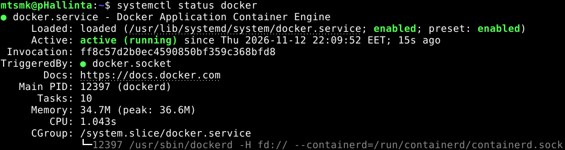

```
sudo docker run hello-world
```

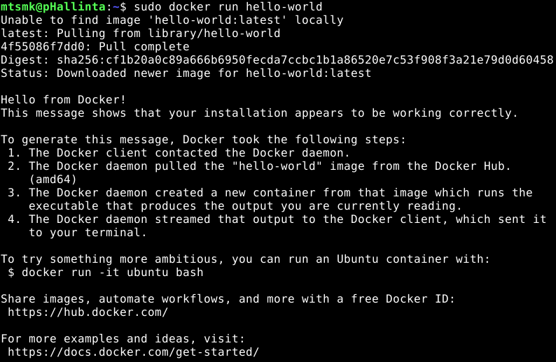

## b) Automaatti. Automatisoi valitsemasi demonin asennus Ansiblella.
### Asennetaan Docker Ansiblella

Ensimmäisenä hankkiuduin eroon Dockerista seuraavilla komennoilla:

```
sudo apt purge docker.io
sudo apt autoremove
```

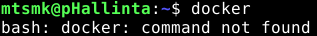

Seuraavaksi loin uuden roolin ja sille taskin.

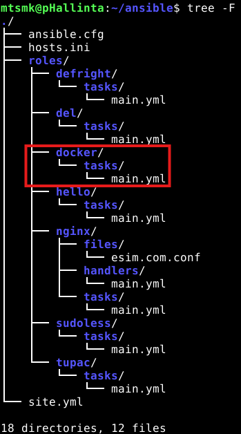

Uuden roolini taskien `main.yml`-tiedostoon lisäsin seuraavan sisällön, jossa:
- Varmistetaan, että _docker.io_-paketti löytyy kohteesta.
- Varmistetaan, että Docker on käynnissä ja käynnistyy koneen mukana.

```
- name: Asennetaan paketti
  apt:
    name: docker.io
    state: present
    update_cache: true

- name: Potkitaan, jos tarve
  service:
    name: docker
    state: started
    enabled: true
```
Sitten lisäsin uuden `docker`-roolini ansible-hakemistoni _site.yml_-tiedostoon.

```
- hosts: all
  become: true
  roles:
    - hello
    - docker
```

Tämän jälkeen suoritin playbookin.

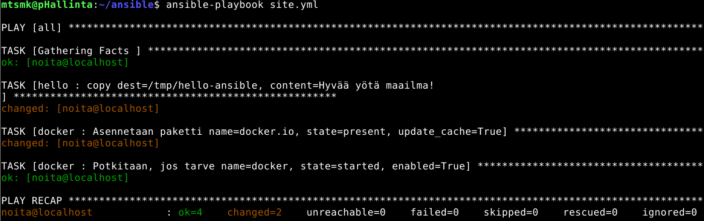

Muutoksia tuli, joten oli aika testata Dockerin toimivan.

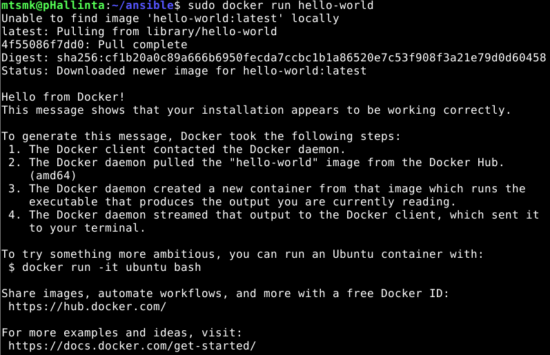

## c) Asetus. Muuta asetustiedostoa herralla ja aja ansible uudestaan.
### Käytetään Ansiblea muuttamaan Dockerin _Live Restore_-asetusta.

Ensimmäisenä tarkistin oletusasetuksen suoraan paketista komennolla `sudo docker info | grep -i "Live Restore"`.

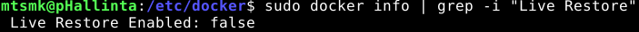

Tehdään asetustiedoston ansible-hakemistooni polkuun `roles/docker/files/`.

Asetustiedosto `daemon.json`:

```
{
	"live-restore": true
}
```

Sitten lisäsin `docker`-roolin ``tasks``-hakemiston ``main.yml``-tiedostoon seuraavan pätkän, jossa:
- Kopioidaan asetustiedosto ansible-hakemistostani Dockerin asetustiedoston paikalle.
- Määritellään sille halutut oikeudet
- Kutsutaan `restart docker`-handleria, joka nimensä mukaisesti käynnistää Dockerin uudelleen.

```
- name: Kopioidaan Dockerin asetustiedosto paikalleen
  copy:
    src: roles/docker/files/daemon.json
    dest: /etc/docker/daemon.json
    mode: "0644"
  notify: restart docker
```

Koko ``roles/docker/tasks/main.yml``-tiedosto tässä vaiheessa:

```
- name: Asennetaan paketti
  apt:
    name: docker.io
    state: present
    update_cache: true

- name: Kopioidaan Dockerin asetustiedosto paikalleen
  copy:
    src: roles/docker/files/daemon.json
    dest: /etc/docker/daemon.json
    mode: "0644"
  notify: restart docker

- name: Potkitaan, jos tarve
  service:
    name: docker
    state: started
    enabled: true
```

Sitten tein kohteeseen ``roles/docker/handlers/`` tiedoston `main.yml`, johon loin handlerin, joka käynnistää Dockerin uudelleen.

```
- name: restart docker
  service:
    name: docker
    state: restarted
```

Tämän jälkeen suoritin playbookin.

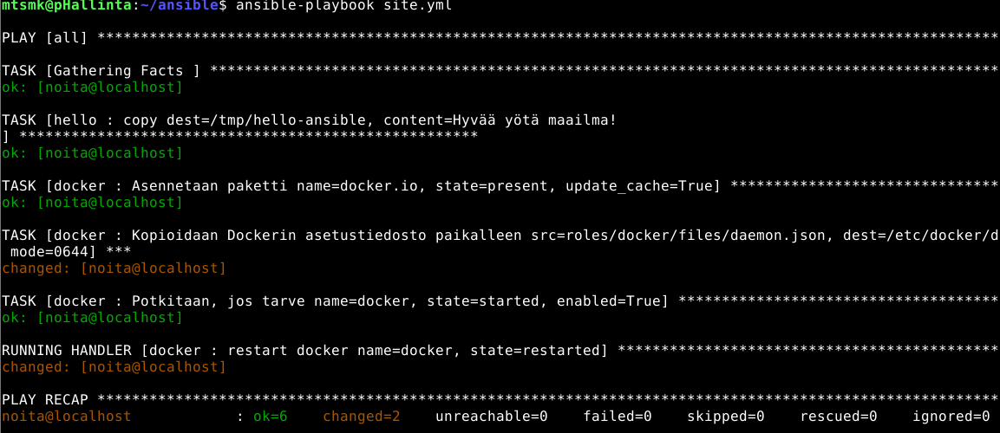

Muutokset vaikuttivat menneen läpi halutusti, joten oli aika tarkistaa asetuksen tilanne.

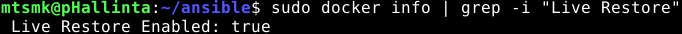

Sitten päätin vielä vaihtaa asetuksen takaisin Ansiblella. Vaihdoin siis `daemon.json`-tiedoston sisällön seuraavanlaiseksi.

```
{
	"live-restore": false
}
```

Sitten suoritin playbookin uudelleen ja katsoin, muuttuiko asetus. Ja kuten seuraavan kuvan pohjasta näkee niin kyllähän se muuttui.

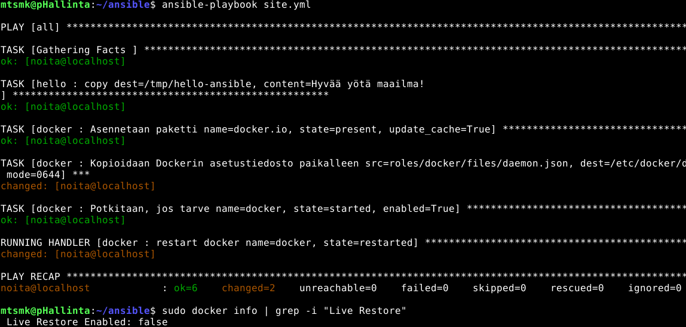

## d) Paikka remonttiin. Riko jotain asetuksia. Sitten aja ansible-roolisi uudestaan ja todista, että se korjaa tilanteen.
### Poistetaan Docker sekä asetustiedosto, ja katsotaan kun Ansible korjaa tilanteen.

Ensimmäiseksi poistin dockerin ja asetuskansion koneeltani seuraavilla komennoilla:

```
sudo apt purge docker.io
sudo apt autoremove
sudo rm -rf /etc/docker
```

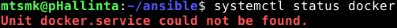

Sitten vaihdoin oman Docker-asetustiedostoni takaisin muotoon `"live-restore": true`, sillä sen oletusarvo paketista tullessaan on `false`.

Sitten juoksutin playbookkia ja katsoin miten kävi.

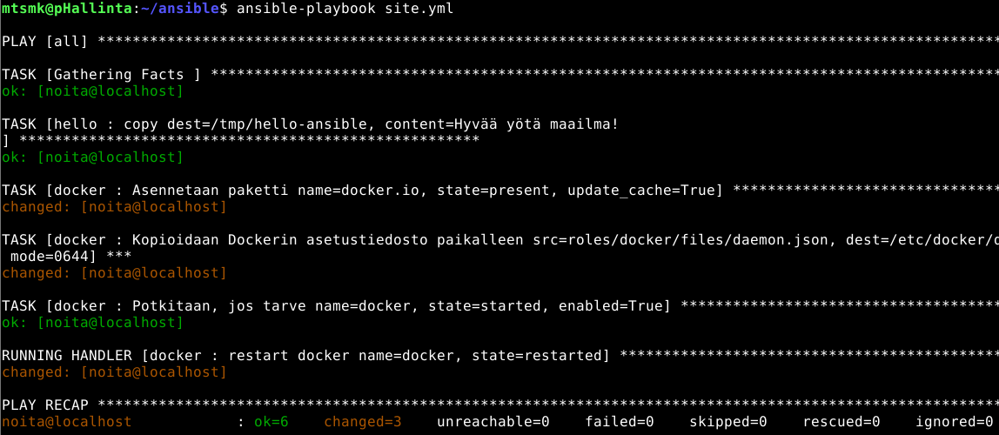

Muutokset menivät heti läpi, joten oli aika varmistaa kaiken toimivan halutusti.

Docker status:

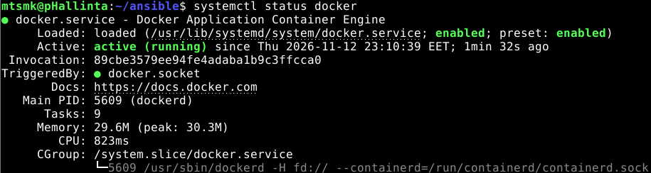

Docker Hello World:

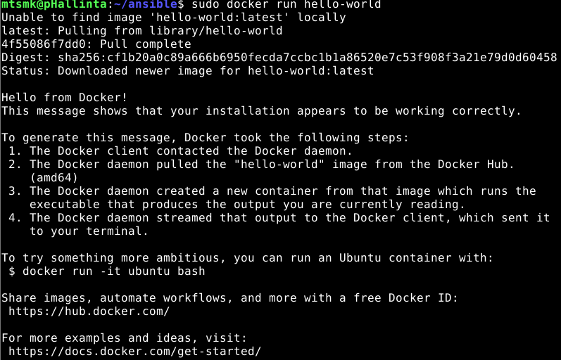

Ansiblella määritetty asetustiedosto:

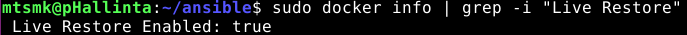

## e) Idempotentti. Osoita, että tilasi on idempotentti.

Lopuksi varmistin tilani olevan idempotentti juoksuttamalla Anssia vielä kerran.

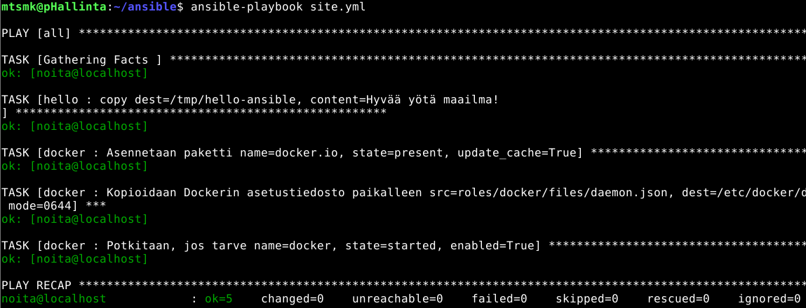

Kuten kuvasta näkyy, muutoksia ei tapahtunut, sillä kohdekone oli jo määritetyssä tavoitetilassa.

## Lähteet

Karvinen T, 2023. Configuration Management of Distributed Systems over Unreliable and Hostile Networks. Luettavissa: https://westminsterresearch.westminster.ac.uk/item/w7vvz/configuration-management-of-distributed-systems-over-unreliable-and-hostile-networks. Luettu 13.11.2026