# Gitar Hero
## x) Lue ja tiivistä.
### Chacon and Straub, 2014. [Pro Git, 2ed:](https://git-scm.com/book/en/v2) [1.3 Getting Started - What is Git?](https://git-scm.com/book/en/v2/Getting-Started-What-is-Git%3F).

- Git on hajautettu versionhallintajärjestelmä, jonka avulla voidaan tallentaa tiedostojen ja projektien eri versioita sekä palata tarvittaessa aikaisempiin versioihin.

- Git tallentaa snapshotteja sen sijaan, että se tallentaisi pelkästään tiedostoihin tehtyjä muutoksia.

- Suurin osa Gitin toiminnoista tapahtuu paikallisesti.

- Git tarkistaa tallentamansa tiedon tiivisteiden perusteella.

Oma huomio: Mukavaa nähdä lohkoketjuja käytössä muuallakin kuin kryptoissa.

### `git add --all && git commit; git pull && git push`.

- `git add` - Lisää nykyisen työhakemiston halutut muutokset valmistelualueelle.
  - `--all` - Määrittää lisättäväksi kaikki muutokset koko repositoriossa.

- `&&` - Suorittaa seuraavan komennon vain, jos edellinen komento onnistui.

- `git commit` - Tallentaa valmistelualueelle siirretyt muutokset pysyvästi käytetyn tietokoneen paikalliseen versionhallintahistoriaan.

- `;` - Erottaa komennot toisistaan ja suorittaa seuraavan komennon riippumatta siitä, onnistuiko edellinen.

- `git pull` - Hakee etävarastosta uusimmat muutokset ja yhdistää ne paikalliseen haaraan.

- `git push` - Lähettää paikalliset commitit etävarastoon, esim. GitHubiin.

#### Lähteet: 

GitLab Docs. [Common Git commands](https://docs.gitlab.com/topics/git/commands/).

Geeksforgeeks, 2020. [Difference Between && and ; chaining operators in Linux](https://www.geeksforgeeks.org/linux-unix/difference-between-chaining-operators-in-linux/).

Oma huomio: Nämä nyt ois vielä saanut selitettyä ilmankin lähteitä.

## a) Online. Tee uusi varasto GitHubiin.

Tein uuden _[sunshine](https://github.com/MTSMK/sunshine)_-nimisen repon GitHubiin.

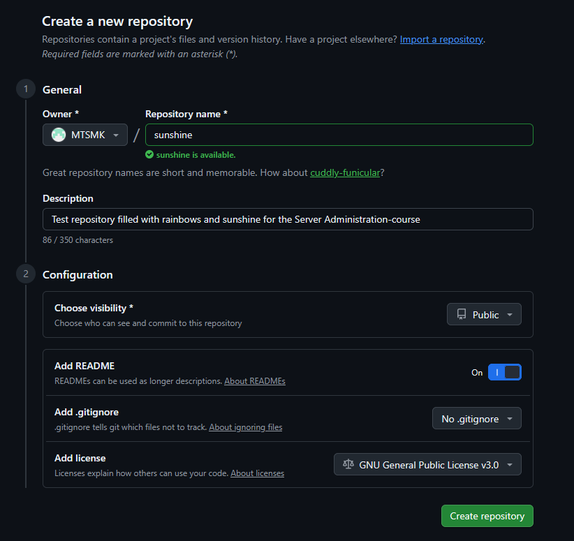

## b) Dolly. Kloonaa edellisessä kohdassa tehty uusi varasto itsellesi, tee muutoksia omalla koneella, puske ne palvelimelle, ja näytä, että ne ilmestyvät weppiliittymään.
### Kloonataan luotu repo kurssia varten luomalleni vm:lle.

Ensimmäiseksi varmistin Gitin löytyvän koneeltani komennolla `git --version`.

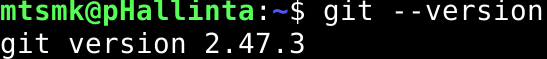

Sieltähän se löytyi, joten seuraavaksi yritin kloonata luomani repon koneelleni `git clone`-komennolla ja GitHubista löytyvällä koodilla.

```
git clone git@github.com:MTSMK/sunshine.git
```

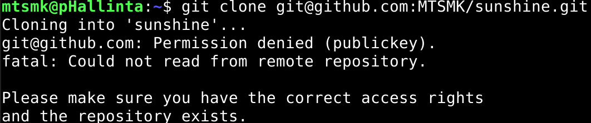


Tämä ei kuitenkaan onnistunut, vaan kompastuin samaan kuoppaan, joka edeltävällä tunnilla käytiin läpi. SSH-avain oli siis jäänyt liittämättä GitHubiin. Täten hain julkisen avaimeni seuraavilla komennoilla:


```
ls ~/.ssh/
cat ~/.ssh/id_ed25519.pub
```

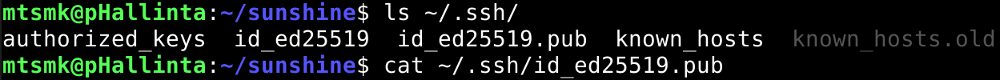

Sieltä kopioin julkisen avaimeni ja lisäsin GitHubiin uuden SSH-avaimen.

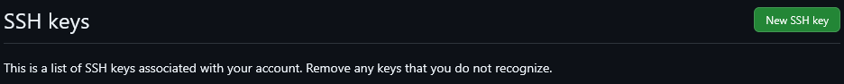

Sitten suoritin uudestaan aiemman kloonauskomennon ja läpihän se meni.

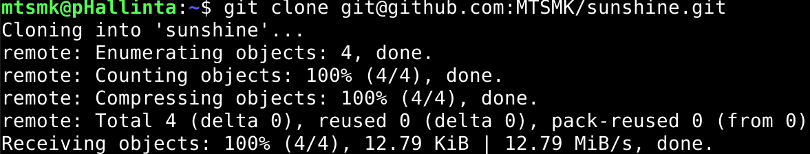

### Tehdään muutoksia vm:llä ja pusketaan ne läpi varastoon

Ensimmäiseksi siirryin _sunshine_-hakemistoon ja tarkistin sen sisällön `ls`-komennolla.

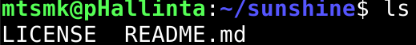

Repossa oli vain lisenssi ja varaston luonnin yhteydessä lisätty _README.md_-tiedosto. Loin sinne tiedoston _sunshine.txt_, johon lisäsin tekstin "Sunshine and rainbows".

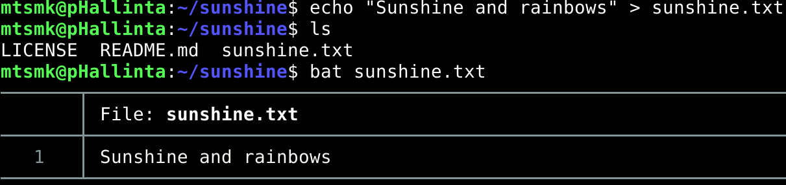

Sitten työnsin tiedoston palvelimelle komennoilla:
```
git add .
git commit
git push
```

- `add`- Komento lisää nykyisen työhakemiston halutut muutokset valmistelualueelle.
  - `.` - Määrittää lisättäväksi kaikki nykyisessä kansiossa ja sen alikansioissa olevat muutokset.
- `commit`-komento tallentaa valmistelualueelle siirretyt muutokset pysyvästi käytetyn tietokoneen paikalliseen versionhallintahistoriaan.
- `push`-komento puolestaan lähettää kaikki paikallisesti tallennetut commitit etäpalvelimelle.

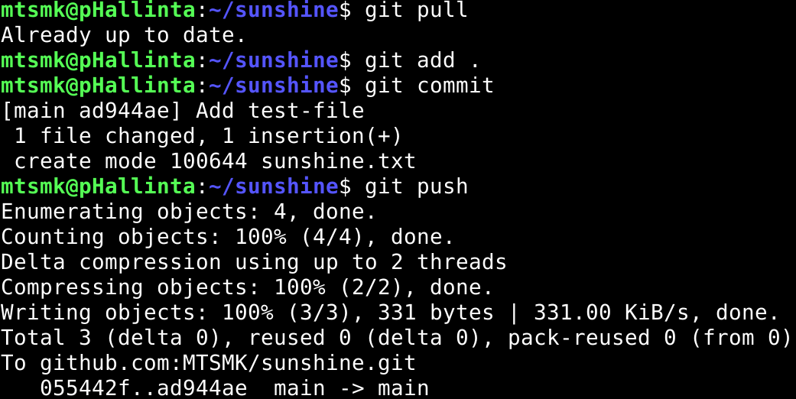

Lopuksi avasin repon selaimestani ja varmistin _sunshine.txt_-tiedoston löytyvän verkkoliittymänkin kautta.

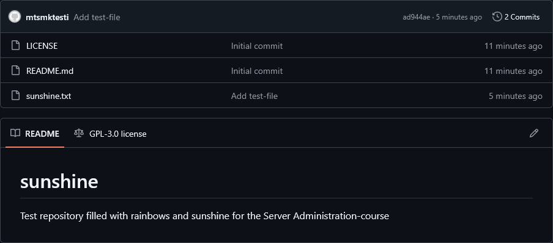

## c) Doh! Tee tyhmä muutos gittiin, älä tee commit:tia. Tuhoa huonot muutokset ‘git reset --hard’.
### Tehdään muutos _README.md_-tiedostoon ja perutaan se.

Valitsin käsittelyyni repon luomisen yhteydessä luodun _README.md_-tiedoston.

Alun perin tiedoston sisältö näytti tältä:

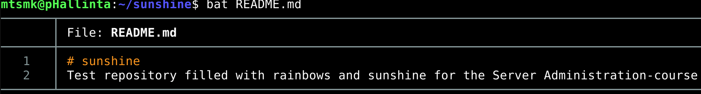

Korvasin _README.md_-tiedoston sisällön tekstillä "Huppista keikkaa".

```
echo "Huppista keikkaa" > README.md
```

Käytin `git status`-komentoa varmistaakseni, että muutos oli tapahtunut. Näin, että _README.md_-tiedostossa oli tapahtunut muutos, joten katsoin sen sisällön.

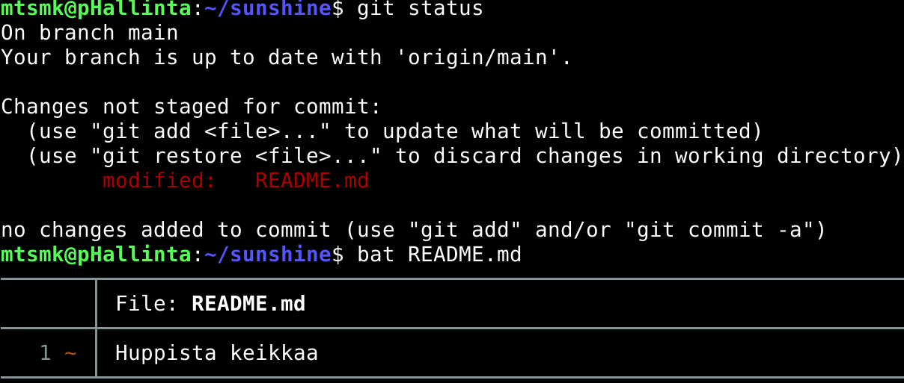

Sitten tulinkin katumapäälle ja halusin peruuttaa muutokset. Tähän käytin komentoa `git reset --hard`. Sitten varmistin tiedoston sisällön palanneen ennalleen.

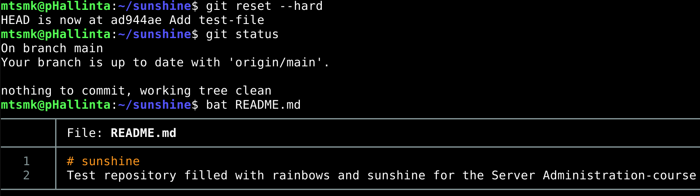

## d) Tukki. Tarkastele ja selitä varastosi lokia. Näytä myös, mitä muutoksia tiedostoihin on tehty.
### Käydään läpi muutama komento lokeja varten.

`git log` **- Näyttää projektin commit-historian aikajärjestyksessä uusimmasta vanhimpaan.**

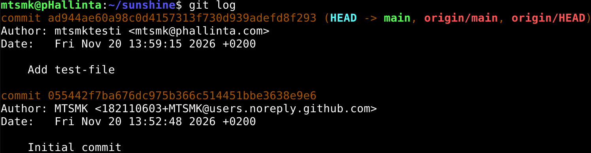

Lokista näkee, että repoon on tehty kaksi committia: _Initial Commit_ ja _Add test-file_. Lokista myös näkee, kuka commitin on tehnyt ja milloin.

`git log --oneline` **- Tulostaa tallennushistorian tiiviissä muodossa, jossa jokainen commit esitetään yhdellä rivillä pelkän lyhennetyn tunnisteen ja viestin kera.**

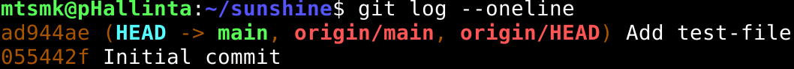

Lokista näkee, että repoon on tehty kaksi committia: _Initial Commit_ ja _Add test-file_.

`git show` **- Näyttää oletuksena viimeisimmän commitin tiedot ja muutokset, kuten commit-viestin ja muutetut tiedostot.**

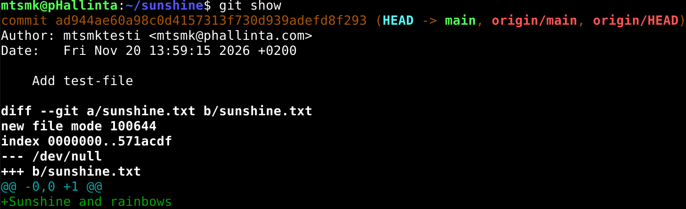

Lokinäkymästä selviävät `ad944ae`-alkuisen commitin tiedot:
- Tekijä ja ajankohta
- Commit-viesti
- Muutetut tiedostot ja niihin tehdyt muutokset


## e) Gitanbile. Laita Ansible-kansio versionhallintaan. Tee jokin muutos, aja ansiblella, tallenna versio.
### Liitetään Ansible-kansio versionhallintaan ja muutetaan kurssin alun hello worldia

Aloitin alustamalla varastoni siirtymällä _ansible_-hakemistooni ja suorittamalla komennon `git init`.

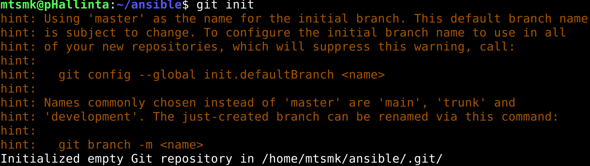

Seuraavaksi committasin jo kurssin aikana luodut tiedostot repoon.

```
git add .
git commit
```

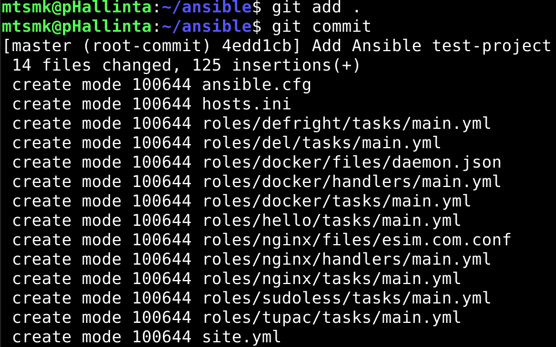

Päätin ottaa käsittelyyni kurssin alussa luodun _hello_-roolin. Sen tarkoitus on varmistaa kohdekoneen `/tmp`-hakemistosta löytyvän _hello-ansible_-niminen tiedosto, jonka sisältö on "Hyvää yötä maailma!\n".

Roolin _main.yml_ tehtävätiedosto näytti alun perin seuraavalta:

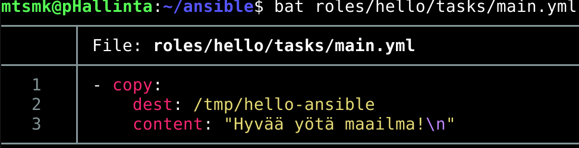

Suoritin playbookin _hello_-roolia käyttäen varmistaakseni taskin toimivan halutusti.

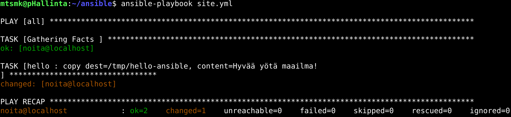

Kirja meni läpi ja muutoksia tapahtui. Varmistin vielä lopputuloksen.

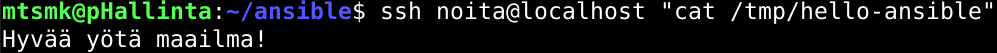

Muutin roolin käsittelemän tiedoston sisällöksi "Hyvää päivää!\n".

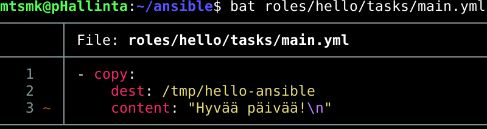

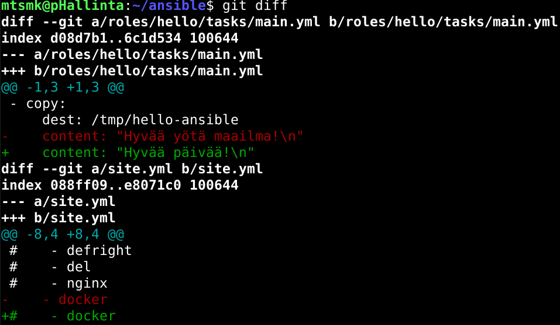

Kuten jälkimmäisestä kuvasta näkee, roolin käsittelemän tiedoston tavoitesisältöä on muutettu. Lisäksi tulosteesta näkee, että olen kommentoinut edellisessä raportissani käyttämäni _docker_-roolin pois käytöstä, jotta minun ei tarvitsisi odotella sen suorittamista turhaan. Tein tämän ennen playbookin ensimmäistä ajoa.

Kun muutokset oli tehty, suoritin playbookin uudestaan.

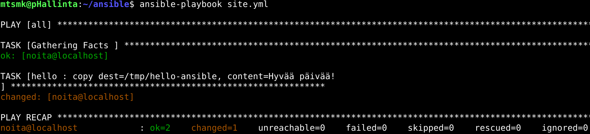

Jälleen kerran läpi meni ja muutoksia tapahtui, joten tarkistin lopputuloksen.

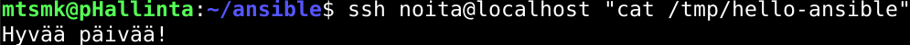

Tavoiteltu lopputulema oli saavutettu, joten oli aika tallentaa muutokset commitilla.

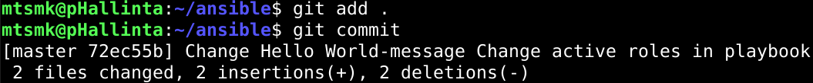

Lopuksi tarkistin lokista, mitä oli tapahtunut.

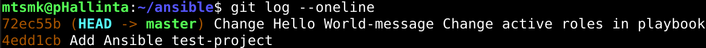

## Lähteet

Chacon and Straub, 2014. Pro Git, 2nd Edition. Luettavissa: https://git-scm.com/book/en/v2. Luettu 20.11.2026.

Geeksforgeeks, 2020. Difference Between && and ; chaining operators in Linux. Luettavissa: https://www.geeksforgeeks.org/linux-unix/difference-between-chaining-operators-in-linux/. Luettu 20.11.2026.

GitLab Docs. Common Git commands. Luettavissa: https://docs.gitlab.com/topics/git/commands/. Luettu 20.11.2026.

